# AI Grand Prix — Autonomous Drone Racing

An autonomy stack for a simulated racing quadrotor, built for the **AI Grand
Prix Virtual Qualifier 2** on the DCL simulator. About **10,000 lines of
Python** covering communications, state estimation, control, monocular
perception, system identification, offline tooling, and a from-scratch
reinforcement-learning pipeline.

This repository publishes **three modules with their tests** and documents the
whole system. The simulator and competition material are licensed and are not
included.

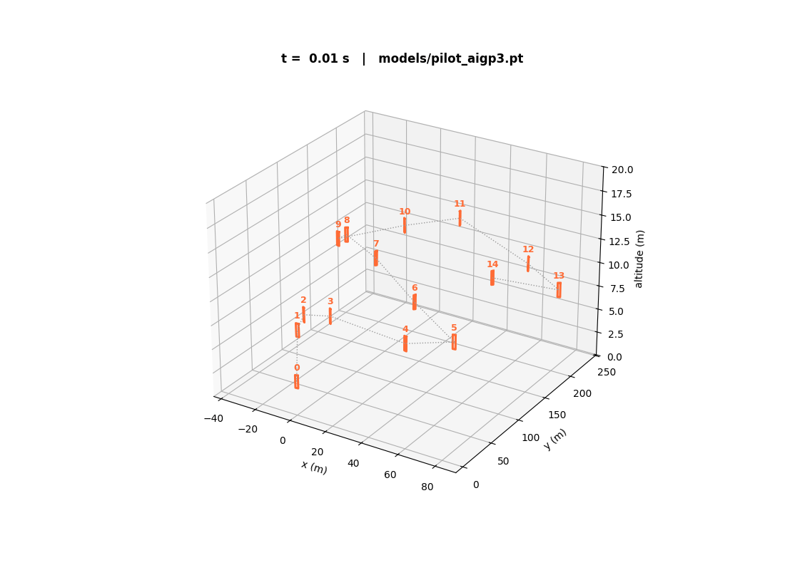

*22 reinforcement-learning agents flying the reconstructed course in parallel.
Orange squares are gates, white dots are drones, trails are recent path.*

---

## 1. What the system is

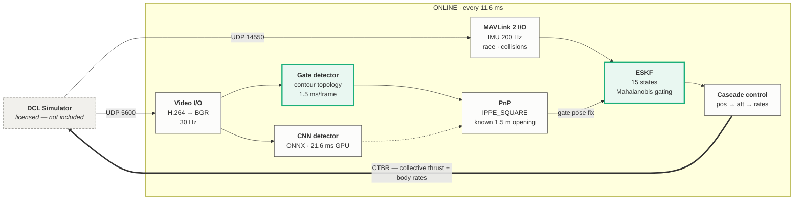

Green outlines mark modules whose source is in this repository.

**The constraint that shaped everything:** the simulator publishes **no
absolute position**. That was established by logging every MAVLink message it
emits — `HIGHRES_IMU`, `ACTUATOR_OUTPUT_STATUS`, `COLLISION`, `HEARTBEAT` and
an encapsulated race/video stream, and nothing else. No `LOCAL_POSITION_NED`,
no `ODOMETRY`. Position comes from the gates themselves or not at all, which
is why PnP against a known 1.5 m gate opening sits at the centre of the
design.

The drone is commanded in **CTBR** — collective thrust plus body rates. That
is the standard interface for agile quadrotor flight, and it is also what an
RL policy emits, so a learned controller drops into the same socket as a
classical one.

---

## 2. How a gate becomes a position fix

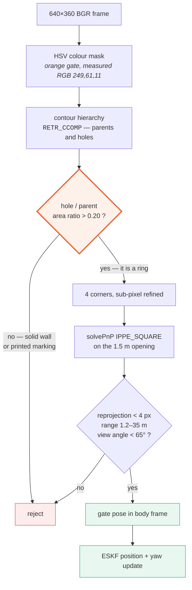

**Why the orange ratio test is the whole trick.** Gates are orange. So is the
wall behind them, and so are the markings printed on the gate frame. Colour
cannot separate those, and a colour-only detector in this stack repeatedly
locked onto the markings — which would fly the drone into the gate it thought
it had found.

What makes a gate a gate is that it is a **ring**: a closed contour containing
a hole, where the hole is a large fraction of its parent's area. That is
topology, not colour, and `cv2.RETR_CCOMP` gives the parent/child hierarchy to
test it directly.

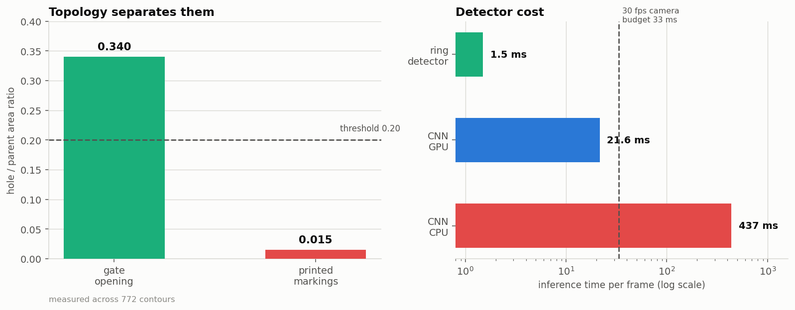

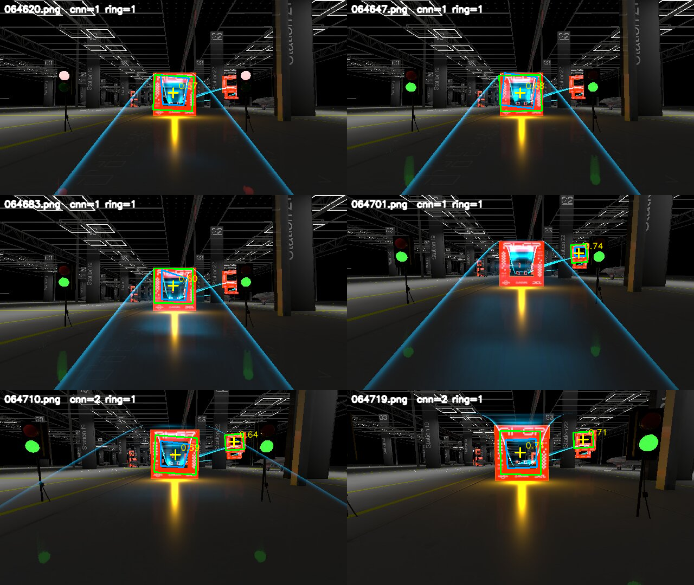

*Both detectors on real simulator footage. Green is the CNN, blue is the
geometric ring detector, yellow crosses are detected gate centres. They agree
on centre to 2.3 px — but measuring the CNN's corner geometry showed its
opposite-side ratio never exceeded 1.06 across 449 frames, versus 1.475 for
the geometric detector. The CNN reports every gate as if viewed head-on, so
its corners are unsafe for PnP even though its centres are good.*

---

## 3. Three ways to fly it

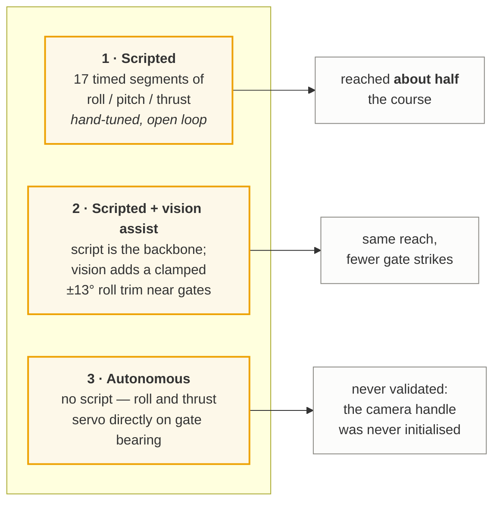

The scripted path was the one that worked. It is a sequence of timed attitude
setpoints, tuned by flying, watching, and changing one number at a time.
That approach has a ceiling, and finding out *why* produced the most
interesting result in the project.

---

## 4. Why a timed script cannot win

A gate crossing is a **level-set crossing**: the drone passes the plane of the
gate at the instant a signed distance changes sign. By the implicit function
theorem, the sensitivity of that crossing time to any trajectory parameter
gives

$$\delta x = v \cdot \delta t$$

Position error equals **speed × timing jitter**. The loop's jitter is pinned
near **0.07 s**, so scatter grows linearly with speed, and for a 1.5 m gate
that implies a hard ceiling:

$$v_{\max} = \frac{w_{\text{gate}}/2}{\delta t} = \frac{0.75}{0.07} \approx 10\ \text{m/s}$$

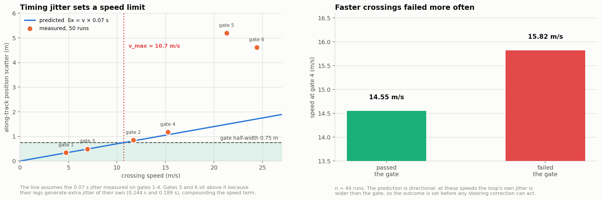

Checked against 50 logged runs: drones that **failed** gate 4 crossed it
**1.27 m/s faster** than those that passed. The path was flying gates 4 and 5
at 15 and 21 m/s — well past the ceiling. That section behaved like a coin
flip regardless of how carefully it was tuned, because it was asking timing to
do something timing physically cannot.

---

## 5. The control loop had to be defended

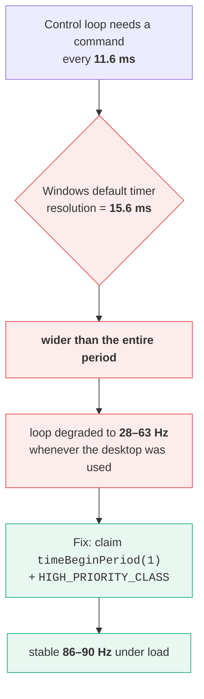

The process had been **free-riding on another application** holding the system
timer at 1 ms, and ran at normal priority so foreground typing preempted it.
Neither is visible in the code; both are visible in the command rate.

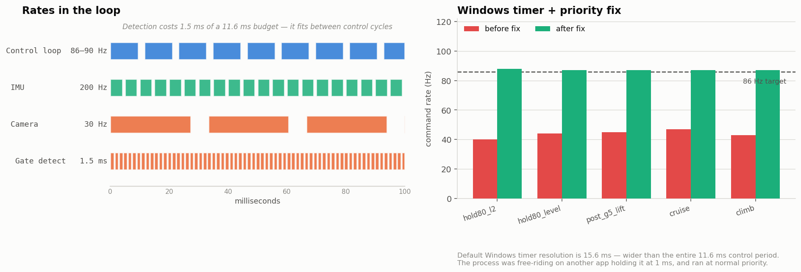

---

## 6. Reinforcement learning, without a physics engine

Isaac Sim earns its RTX requirement on rendering and contact-rich physics —
articulated arms, grasping, cloth. A quadrotor racing through gates has none
of that. Its state is 13 floats, its dynamics are about ten lines of
arithmetic, and "did it pass the gate" is a signed plane crossing plus a
radius test. All of it batches, so **N drones cost almost what one costs**.

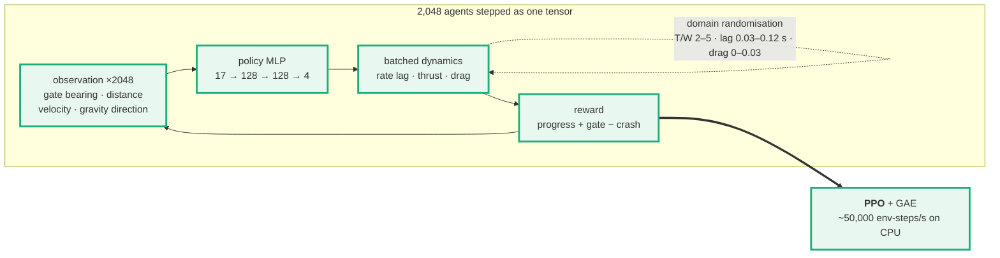

**Domain randomisation is the point.** Every agent flies a different aircraft
— thrust-to-weight anywhere from 2 to 5, rotor lag 0.03–0.12 s, drag 0–0.03.
The policy therefore cannot learn "command 0.30 throttle"; it has to sense the
response and adapt. You do not need a *correct* dynamics model, you need a
distribution that **contains** the truth — which is exactly the property the
hand-tuned path never had, since every number in it was pinned to one assumed
constant.

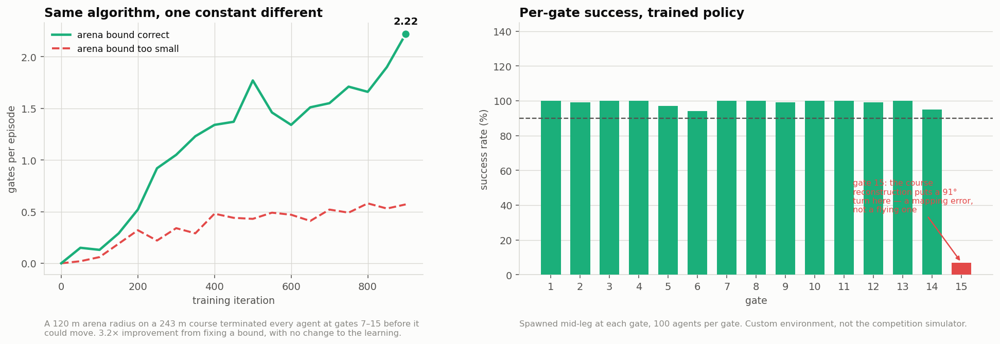

---

## 7. Results

| measurement | value | measured where |
|---|---|---|
| Control loop rate | **86–90 Hz** sustained | competition sim |
| Gate detector | **1.5 ms/frame** | measured in tests |
| PnP reprojection error | **0.33 px** median, 94.8% under 2 px | competition sim, 1,254 observations |
| CNN inference CPU → GPU | **437 ms → 21.6 ms (20×)** | ONNX Runtime + DirectML, GTX 1650 |
| Gate sighting interval | **0.035 s** median, 98.4% under 0.5 s | competition sim, 6 runs |
| **Course reached** | **about half the course** (~7-8 gates) | **competition sim** |
| RL environment throughput | **383k steps/s** idle, **50k** training | 8-core CPU, no GPU |
| RL per-gate success | **94–100% on 14 of 15 gates** | **custom sim** |
| RL gates per episode | 0.00 → **2.22** | **custom sim** |

**Read this carefully.** Everything marked *competition sim* ran against the
actual simulator. The reinforcement-learning numbers ran in the environment in
[`rl/`](rl) — a dynamics model fitted to logged flights, on a course
reconstructed from a hand-drawn map fused with measured leg lengths and
altitudes. **The RL agent receives gate positions directly, not through the
camera, and has never flown the competition simulator.**

The scripted stack reached **about half the course** — roughly 7-8 gates.
Two caveats on that number, both of which I only pinned down afterwards: the
simulator's `active_gate_index` starts at **0**, so a reported "gate 6" is the
**seventh** gate passed; and the hand-drawn course map is missing one or two
gates at the far end, so the denominator is approximate too. The course is a
single lap-free circuit, and **it was never completed** — the second half was
never flown, so nothing beyond the halfway point in this repository is
measured.

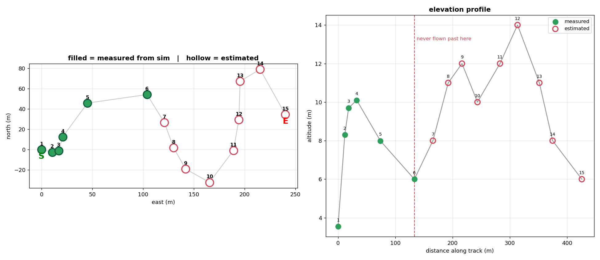

*Course reconstruction. Filled green gates were measured from 50 logged runs;
hollow red are estimated from the hand-drawn map. The drone never flew the
second half, so everything past the halfway point is inference — and the map
itself is missing one or two gates at the far end.*

---

## 8. Published modules

| module | what it is | tests |
|---|---|---|
| [`estimation/`](estimation) | 15-state ESKF, IMU propagation with vision updates, Mahalanobis outlier gating, process noise that inflates while blind | **21** |
| [`perception/`](perception) | gate detection by contour topology rather than colour | **15** |
| [`rl/`](rl) | 2,048-agent vectorised quadrotor environment + PPO | **27** |

```bash
pip install -r requirements.txt
cd estimation  && pytest -v      # 21 passed
cd ../perception && pytest -v    # 15 passed
cd ../rl        && pytest -v -s  # 27 passed

# train a policy from scratch, ~20 min on CPU
cd rl && python ppo.py --course aigp --envs 2048 --iters 900 \
    --gamma 0.995 --max-steps 900 --save pilot.pt
python viz.py --course aigp --ckpt pilot.pt --gif flight.gif
```

Each directory is standalone — no cross-imports, no package install.

---

## 9. What this project actually taught

Three separate failures presented as *"this approach does not work"* when the
truth was *"this code never ran"*:

| symptom | actual cause |
|---|---|
| CNN far too slow to use | `providers=["CPUExecutionProvider"]` hardcoded — the GPU sat idle |
| Autonomous mode flew dead straight | its camera handle was never initialised, so it took the "no gate visible" branch every cycle |
| RL policy "could not fly" gates 7–15 | a 120 m arena bound on a 243 m course terminated every agent before it could move |

The third was worth **3.2×** on the headline metric, from changing one
constant, with no change to the learning algorithm.

Writing the tests in this repository found a fourth: one non-finite IMU sample
permanently poisoned position, velocity **and** the covariance, and since every
later update is a function of the covariance, the filter returned NaN forever
while still looking like a running filter. Fixed in `estimation/eskf.py`.

A broken estimator does not crash. A broken RL environment does not raise — it
trains.

---

## Not included

The DCL simulator, the competition technical specification, and the raw flight
logs are licensed material and not mine to redistribute. Nothing here depends
on them: the three modules run on synthetic inputs and every test is
self-contained.
